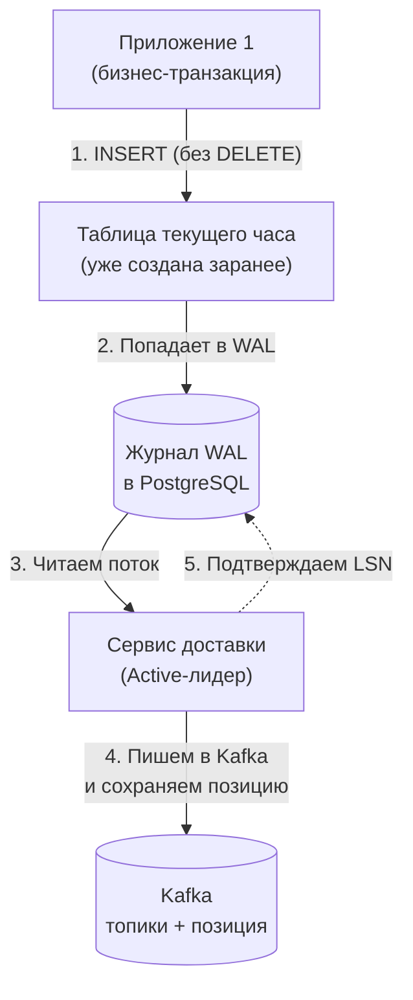
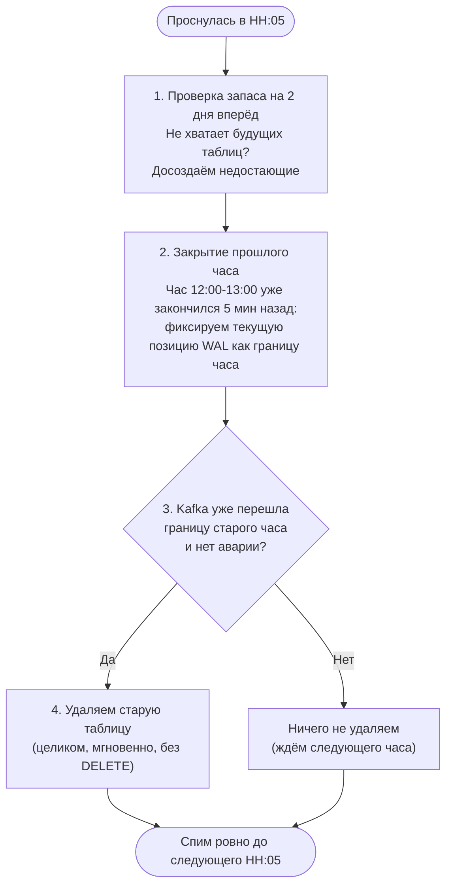
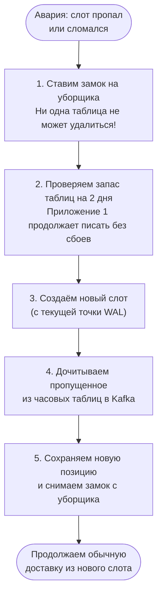
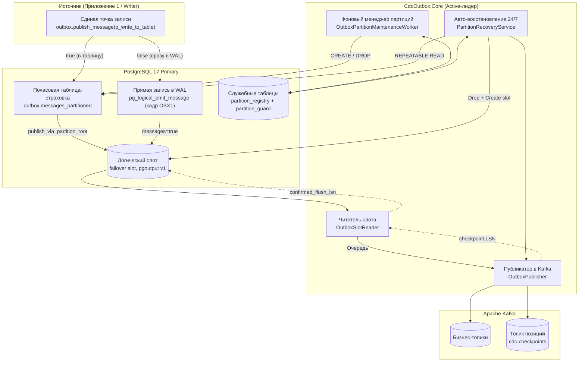
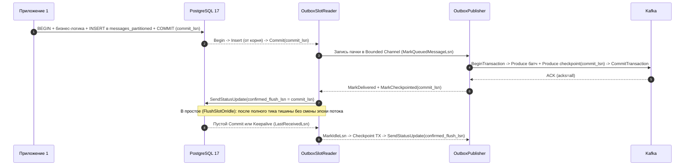
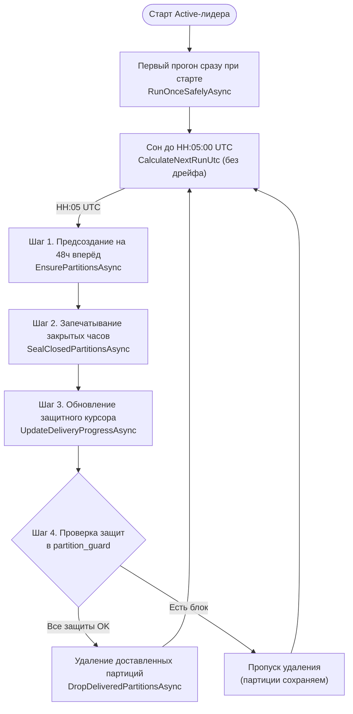
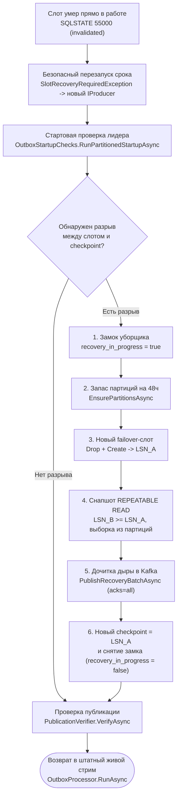

# Режимы `PartitionedTable` и `WalMessages`: как это работает

Документ разделён на две части:
1. **Простое объяснение (без кода и SQL)** — 3 лёгкие схемы, чтобы за минуту понять всю идею целиком.
2. **Техническая часть (под капотом)** — схемы `2.1`–`2.4`, где **каждый квадратик разобран простым человеческим языком** с привязкой к конкретным классам C#, SQL-функциям, таблицам и метрикам.

---

# Часть 1. Как это работает (простыми словами)

## 1.1. Как сообщение идёт в обычном режиме (`INSERT` в почасовую таблицу)

Главное отличие от классического варианта: Приложение 1 **только вставляет (`INSERT`)** и никогда не делает `DELETE` — поэтому на таблице нет мёртвых строк и нагрузки от `autovacuum`.



> [!TIP]
> Если переключить флаг `p_write_to_table = false`, шаг с таблицей пропускается и сообщение летит **напрямую в журнал WAL** (целевой режим `WalMessages`). Слот пересоздавать не нужно.

---

## 1.2. Что делает фоновая джоба раз в час (в `HH:05`)

Джоба работает **только на активном лидере**. Первый раз — сразу при старте, дальше — раз в час ровно в `HH:05` (например `13:05`, `14:05`, `15:05`).



**Как это выглядит по часам на примере таблицы `12:00–13:00`:**
- **За 48 часов до `12:00`** — таблица уже создана пустой про запас (если джоба вдруг сломается, есть 2 дня на реакцию).
- **`12:00–13:00`** — Приложение 1 спокойно делает в неё `INSERT`.
- **`13:05`** — джоба фиксирует границу WAL для часа `12:00–13:00` (5 минут запаса нужны, чтобы транзакции, начатые в `12:59`, успели закоммититься). При этом таблица `11:00–12:00` уже удаляется.
- **`14:05`** — джоба видит, что Kafka давно прошла границу `13:05`, и **удаляет таблицу `12:00–13:00`**. Если Kafka стояла 3 часа, таблица просто ждёт на диске; когда Kafka догонит — джоба снесёт все доставленные часы за один раз.

---

## 1.3. Что происходит, если слот WAL умер (авто-восстановление 24/7)

Если слот удалили, переполнился WAL или произошёл сбой кластера — **люди не нужны**, сервис чинит себя сам и ничего не теряет благодаря сохранённым часовым таблицам.



**Почему при этом ничего не теряется:**
1. Замок гарантирует, что уборщик не удалит старые таблицы, пока мы не вычитаем «дыру».
2. Сначала создаётся **новый слот** (точка `A`), и **сразу после** делается чтение из часовых таблиц (снимок `B >= A`). Всё, что было до `A`, попадает в снимок; всё, что после `A`, поймает новый слот.

---

# Часть 2. Техническая схема (под капотом — с расшифровкой каждого блока)

## 2.1. Компоненты и переключатель режимов



### Что такое кадр `OBX1` (на ветке `p_write_to_table = false`)

В PostgreSQL функция `pg_logical_emit_message(true, prefix, payload)` принимает **одно поле `bytea`**, а не 9 колонок таблицы (`topic`, `key`, `body`, `headers`, `partition` и т.д.). Поэтому для безтабличного режима мы упаковываем все поля сообщения в компактный бинарный контейнер **`OBX1`** (**O**ut**b**o**x** версия **1**, big-endian):
- первые 4 байта — сигнатура `"OBX1"` (`0x4F425831`): защищает декодер от случайного текста/JSON/битых байт и позволяет в будущем без даунтайма ввести `OBX2`;
- следующие 4 байта — `count` (число сообщений в кадре): **на проде из `outbox.publish_message` всегда `count = 1`** (строго 1-к-1), а нагрузочный генератор `testloop/Writer` в режиме `WalEmit` может упаковать свой батч сразу целиком;
- далее поля каждого сообщения (`id`, `created_at` в мкс, флаги, `partition?`, `topic`, `key`, `body`, `headers`, `producer_key?`).

### Расшифровка каждого блока схемы 2.1 простыми словами

| Блок на схеме | Что делает простыми словами | Где в коде / БД |
|---|---|---|
| **Единая точка записи (`outbox.publish_message`)** | SQL-функция для Приложения 1 с флагом `p_write_to_table`: при `true` делает `INSERT` в текущую часовую партицию, при `false` сразу шлёт бинарный кадр `OBX1` в WAL без таблицы. | `04-wal-and-partitions.sql` (`outbox.publish_message`, `outbox.emit_frame`) |
| **Почасовая таблица-страховка (`messages_partitioned`)** | Таблица с теми же 9 колонками, что и штатная `outbox.messages`, но нарезанная по часам (`RANGE` по `created_at`). Приложение делает только `INSERT` без `DELETE` — нет bloat и `autovacuum`. | `04-wal-and-partitions.sql`, публикация `outbox_partitioned_publication` с `publish_via_partition_root = true` |
| **Прямая запись в WAL (`pg_logical_emit_message`)** | Запись сообщения прямо в журнал WAL внутри бизнес-транзакции (если транзакция откатится — сообщение не уйдёт в Kafka). Таблица на диске не трогается вообще. | `04-wal-and-partitions.sql`, пустая публикация `outbox_wal_publication` |
| **Логический слот (`failover slot`)** | Курсор PostgreSQL, который отдаёт сервису закоммиченные изменения строго в порядке `COMMIT` и синхронизируется на standby в PostgreSQL 17 (`failover = true`). | `OutboxSlotProvisioner.cs` |
| **Служебные таблицы (`partition_registry` + `partition_guard`)** | Две крошечные таблицы (несколько КБ, в Kafka не попадают): первая хранит список часовых партиций и их отсечку `sealed_lsn`, вторая — подтверждённую позицию `checkpoint`, ID кластера и замок восстановления. | `04-wal-and-partitions.sql`, `PartitionRegistryClient.cs` |
| **Читатель слота (`OutboxSlotReader`)** | Читает из одного слота и табличные `INSERT`, и прямые WAL-кадры `OBX1` (при `EnableWalMessages = true`), буферизует транзакцию до `COMMIT` и безопасно двигает слот в тихий простой (`FlushSlotOnIdle`). | `OutboxSlotReader.cs`, `WalOutboxFrameCodec.cs` |
| **Публикатор в Kafka (`OutboxPublisher`)** | Берёт сообщения из внутренней очереди, отправляет пачку в бизнес-топики и новую позицию LSN в `cdc-checkpoints` **одной атомарной Kafka-транзакцией** (`acks = all`). | `OutboxPublisher.cs`, `CheckpointStore.cs` |
| **Фоновый менеджер партиций (`OutboxPartitionMaintenanceWorker`)** | Работает только на активном лидере: раз в час (в `HH:05`) досоздаёт пустые партиции на 48ч вперёд, запечатывает закрытые часы и удаляет доставленные. | `OutboxPartitionMaintenanceWorker.cs` |
| **Авто-восстановление 24/7 (`PartitionRecoveryService`)** | Если слот умер или потерялся, сам ставит замок на уборщика, пересоздаёт `failover`-слот, дочитывает пропущенное из сохранённых партиций в Kafka и возвращает сервис в строй без людей. | `PartitionRecoveryService.cs`, `OutboxStartupChecks.cs` |
| **Бизнес-топики и `cdc-checkpoints`** | Целевые топики Kafka для событий и служебный топик (1 партиция, `compact`), где хранится подтверждённый `checkpoint` LSN и выбирается единственный активный лидер. | `CheckpointStore.cs`, `LeadershipCoordinator.cs` |

### Сводка по трём режимам (`CdcOutbox:Storage:Mode`)

| Режим | Publication | Хранение в БД | Джоба партиций | Авто-восстановление 24/7 |
|---|---|---|---|---|
| `Table` *(по умолчанию)* | `outbox_publication` | `outbox.messages` (`INSERT+DELETE`) | Выключена | Штатный ручной `RecoveryMode` |
| `WalMessages` | `outbox_wal_publication` (пустая) | Нет таблицы (только WAL `OBX1`) | Выключена | Штатный ручной `RecoveryMode` |
| `PartitionedTable` | `outbox_partitioned_publication` (`publish_via_partition_root=true`) | `outbox.messages_partitioned` (`INSERT`-only) | Включена автоматически на Active | Включено автоматически (`AutoRecoverFromPartitions=true`) |

---

## 2.2. Сквозная последовательность доставки и простоев (`OutboxSlotReader` → `OutboxPublisher`)



### Расшифровка шагов схемы 2.2 простыми словами

| Шаг на схеме | Что происходит простыми словами | Зачем это нужно |
|---|---|---|
| **Шаг 1 (`App → PG`)** | Приложение 1 в одной транзакции сохраняет свои бизнес-данные и вставляет строку в `messages_partitioned` (PostgreSQL сам кладёт её в нужную часовую партицию по `created_at`). | Атомарность: либо закоммитились и бизнес-данные, и событие в outbox, либо откатилось всё вместе. |
| **Шаг 2 (`PG → Reader`)** | PostgreSQL присылает изменения строго в порядке `COMMIT`. Благодаря `publish_via_partition_root = true` сервис видит имя родительской таблицы, а не сотни имён часовых секций. | Не нужно перечитывать схему при создании новой часовой партиции; откаченные транзакции вообще не доходят до Kafka. |
| **Шаг 3 (`Reader → Pub`)** | Читатель кладёт сообщения в ограниченную очередь в памяти (`QueueCapacity`) и запоминает их максимальный LSN (`MarkQueuedMessageLsn`). | Если Kafka затормозила — очередь заполняется и чтение слота мягко притормаживается (backpressure), память не переполняется. |
| **Шаги 4–5 (`Pub ↔ Kafka`)** | Публикатор открывает транзакцию Kafka, отправляет пачку событий и в той же транзакции пишет `checkpoint = commit_lsn` в `cdc-checkpoints`, затем ждёт `ACK` от брокера (`acks = all`). | Математическая гарантия: `checkpoint` не может сдвинуться вперёд, пока брокер Kafka не сохранил все сообщения до этого `commit_lsn`. |
| **Шаги 6–7 (`Pub → Reader → PG`)** | После `ACK` обновляется позиция в памяти (`ReplicationProgress`), читатель просыпается и отправляет PostgreSQL `confirmed_flush_lsn = commit_lsn`. | Только теперь PostgreSQL разрешается освободить прочитанный участок WAL. |
| **Шаги 8–9 (`FlushSlotOnIdle`)** | Ночью без outbox-сообщений PostgreSQL шлёт keepalive или пустые коммиты чужих таблиц. Читатель проверяет, что все сообщения из очереди уже доставлены и целый интервал не было новых данных, и аккуратно сдвигает `checkpoint` и слот вперёд. | Защита от роста WAL при простое и возможность удалить старые партиции даже в тихую ночь без трафика — без риска перескочить незакоммиченную транзакцию. |

---

## 2.3. Внутренние шаги джобы `OutboxPartitionMaintenanceWorker`



### Расшифровка каждого блока схемы 2.3 простыми словами

| Блок на схеме | Что делает простыми словами | SQL / настройки / метрики |
|---|---|---|
| **Старт Active-лидера и первый прогон** | Джоба запускается **только на активном экземпляре** (standby ничего не создаёт и не удаляет). Первый цикл идёт сразу при получении лидерства, чтобы запас на 48ч появился мгновенно, не дожидаясь следующего часа. | `OutboxProcessor.cs`, `OutboxPartitionMaintenanceWorker.cs` |
| **Сон до `HH:05:00 UTC`** | Вычисляет точное время до следующей отметки `HH:05:00 UTC` (а не «+60 минут от конца прошлого запуска»), поэтому расписание никогда не уплывает. При потере лидерства сон мгновенно прерывается. | `HourlyPartitionName.CalculateNextRunUtc`, `RunAtMinuteOfHour = 5` |
| **Шаг 1. Предсоздание на 48ч вперёд** | Проверяет текущий час и все 48 будущих часов (2 дня про запас). Если какой-то партиции не хватает (новый час или кто-то удалил вручную) — идемпотентно досоздаёт её и регистрирует в `partition_registry`. | `outbox.ensure_partitions(...)`, `PrecreateHours = 48`, метрики `outbox_future_partitions_count` (алерт `< 24`), `outbox_partitions_created_total` |
| **Шаг 2. Запечатывание закрытых часов** | Для всех часов, которые закончились минимум `SealGraceMinutes` (5 минут) назад и ещё не запечатаны, записывает в `partition_registry.sealed_lsn` текущий `pg_current_wal_lsn()`. Это верхняя граница WAL, после которой в тот час уже ничего не попадёт. | `outbox.seal_closed_partitions(...)`, `SealGraceMinutes = 5` |
| **Шаг 3. Обновление защитного курсора** | Берёт подтверждённый `checkpoint` из памяти и `system_identifier` кластера и монотонно двигает `partition_guard.contiguous_delivered_lsn` вперёд (но только если не идёт восстановление и кластер тот же). | `outbox.update_partition_guard_progress(...)`, `pg_control_system()` |
| **Шаг 4. Проверка защит в `partition_guard`** | Проверяет 4 условия сразу: 1) курсор инициализирован; 2) замок `recovery_in_progress = false`; 3) не поменялся `system_identifier` кластера; 4) подтверждённый LSN обогнал `sealed_lsn` партиции (и вышел `RetentionHours`). | `PartitionRegistryClient.DropDeliveredPartitionsAsync`, `RetentionHours = 0` |
| **Удаление доставленных партиций** | По умолчанию вызывает `SECURITY DEFINER`-функцию от имени роли `sys_replication` (права владельца не нужны, стоит `lock_timeout = 2s` — при конкурентном локе просто пропускает до след. часа). При `UseSecurityDefinerFunctions = false` делает `DETACH PARTITION CONCURRENTLY` + `DROP TABLE`. | `outbox.drop_delivered_partitions(...)`, `UseSecurityDefinerFunctions = true`, метрика `outbox_partitions_dropped_total` |
| **Пропуск удаления / ошибка цикла** | Если не прошла любая защита — партиции остаются целыми на диске. Если в фоновой джобе случилась любая ошибка БД — она логируется и попадает в метрику ошибок, **не останавливая живую доставку в Kafka**. | `OutboxPartitionMaintenanceWorker.RunOnceSafelyAsync` |

---

## 2.4. Внутренний поток 24/7 авто-восстановления (`LeadershipCoordinator` + `PartitionRecoveryService`)



### Расшифровка каждого блока схемы 2.4 простыми словами

| Блок на схеме | Что делает простыми словами | Где в коде / БД / метриках |
|---|---|---|
| **Слот умер прямо в работе** | Например, WAL переполнился и PostgreSQL пометил слот как `wal_status = 'lost'` (инвалидирован) прямо во время доставки. | `OutboxSlotReader.FindReadingIssue` (SQLSTATE `55000`) |
| **Безопасный перезапуск срока** | Вместо падения хоста `OutboxProcessor` аккуратно доотправляет буфер канала, закрывает старый `OutboxPublisher` и передаёт управление координатору лидерства. Координатор закрывает старый `IProducer` и создаёт свежий (чтобы не было многопоточного конфликта с Kafka-продюсером). | `OutboxProcessor.cs` (`SlotRecoveryRequiredException`), `LeadershipCoordinator.SuperviseDeliveryAsync` |
| **Стартовая проверка и детектор разрыва** | Запускается при каждом старте/перезапуске лидера и проверяет 5 признаков аварии: 1) прошлое восстановление оборвалось (`recovery_in_progress = true`); 2) слот инвалидирован; 3) сменился `system_identifier` кластера; 4) слот удалён при живом checkpoint; 5) `confirmed_flush` ускакал вперёд `checkpoint`. | `OutboxStartupChecks.DetectPartitionRecoveryReasonAsync` |
| **1. Замок уборщика** | Ставит `recovery_in_progress = true` в `partition_guard`. Пока этот флаг поднят, ни один цикл уборки не сможет удалить старые партиции — даже если сервис перезапустится на полпути. | `PartitionRegistryClient.SetRecoveryLockAsync(true)` |
| **2. Запас партиций на 48ч** | Сразу проверяет и досоздаёт будущие партиции, чтобы во время восстановления Приложение 1 не упало при `INSERT` в новый час. | `PartitionRegistryClient.EnsurePartitionsAsync` |
| **3. Новый failover-слот (`LSN_A`)** | Удаляет мёртвый/устаревший слот и создаёт свежий слот `pgoutput` с `failover = true` на текущей позиции `LSN_A`. Все новые коммиты после `LSN_A` гарантированно начнут копиться в этом слоте. | `OutboxSlotProvisioner.DropSlotIfExistsAsync` + `CreateFailoverSlotAndReturnLsnAsync` |
| **4. Снапшот `REPEATABLE READ` (`LSN_B >= LSN_A`)** | Сразу после создания слота открывает транзакцию `REPEATABLE READ`. Так как снимок `LSN_B` взят строго не раньше `LSN_A`, он математически видит **100% всех транзакций, закоммиченных до `LSN_A`**. Читает строки начиная с `LastDeliveredCreatedAtUtc - 5 мин` (перекрытие для at-least-once). | `PartitionRecoveryService.ReplayFromSnapshotAsync`, `RecoveryOverlapMinutes = 5` |
| **5. Дочитка дыры в Kafka** | Потоково (батчами по `RecoveryBatchSize = 1000`) отправляет найденные строки в Kafka через транзакционный `OutboxPublisher` (`acks = all`), не нагружая память. | `OutboxPublisher.PublishRecoveryBatchAsync`, `RecoveryBatchSize = 1000` |
| **6. Новый `checkpoint` и снятие замка** | Атомарно сохраняет `checkpoint = LSN_A` в `cdc-checkpoints` и **только после этого** снимает замок `recovery_in_progress = false` в `partition_guard`. Фиксирует метрики авто-восстановления. | `CheckpointStore.SaveTransactionAsync`, `outbox_partition_auto_recoveries_total`, `outbox_partition_recovered_messages_total` |
| **Проверка публикации → Живой стрим** | Проверяет, что `outbox_partitioned_publication` корректна (`publish = 'insert'`, `publish_via_partition_root = true`), и запускает обычный живой стрим с нового слота `LSN_A`. | `PublicationVerifier.VerifyAsync`, `OutboxProcessor.RunAsync` |

---

## 2.5. Быстрое переключение режимов на стенде

```bash
# 1. Штатный режим (по умолчанию — без изменений)
docker compose up -d

# 2. Страхующие почасовые партиции (INSERT-only, 48ч запас, очистка в HH:05, 24/7 авто-восстановление)
CDCOUTBOX__STORAGE__MODE=PartitionedTable \
CDCOUTBOX__STORAGE__TABLE=messages_partitioned \
CDCOUTBOX__STORAGE__ENABLEWALMESSAGES=true \
CDCOUTBOX__REPLICATION__PUBLICATIONNAME=outbox_partitioned_publication \
WRITER__DEFAULTS__WRITEMODE=InsertOnly \
WRITER__DEFAULTS__TABLENAME=outbox.messages_partitioned \
docker compose up -d

# 3. Целевой безтабличный WAL (pg_logical_emit_message, формат OBX1, пустая publication)
CDCOUTBOX__STORAGE__MODE=WalMessages \
CDCOUTBOX__REPLICATION__PUBLICATIONNAME=outbox_wal_publication \
WRITER__DEFAULTS__WRITEMODE=WalEmit \
docker compose up -d
```

Все параметры конфигурации описаны в [CONFIGURATION.md](CONFIGURATION.md), а метрики — в [METRICS.md](METRICS.md).
